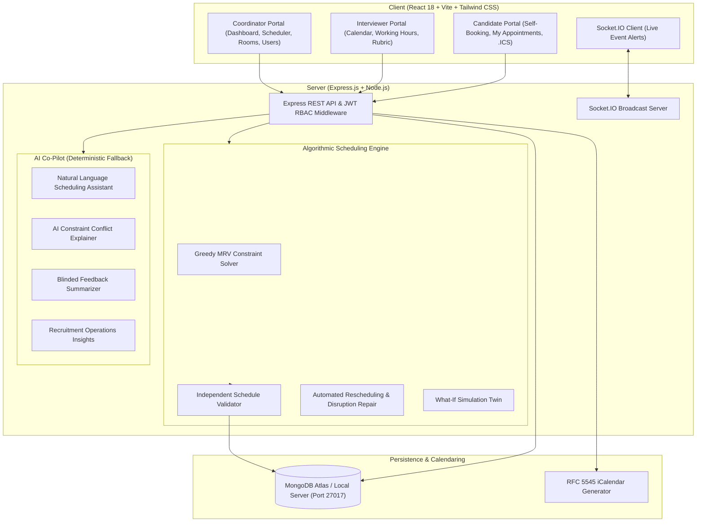
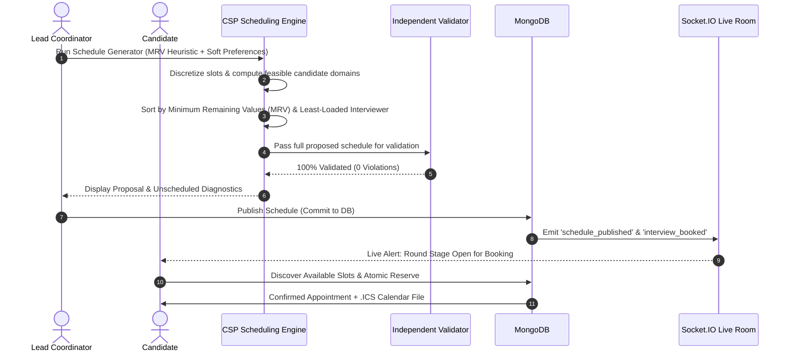

# SlotSync: Campus Recruitment & Interview Scheduling Platform

**Competition:** CodeSangam 2026 / Webster  
**Problem Statement:** Problem Statement 05 — The Ancient One's Trials  
**Team Name:** TriStack  
**Team ID:** 211  
**Team Members:**  
- **Shreyansh Agrawal** (Reg. No: `20243268`, CSE)  
- **Nipun Gupta** (Reg. No: `20243185`, CSE)  
- **Krishnaraj Singh** (Reg. No: `20243278`, CSE)  

---

## 1. Project Overview

SlotSync is a modern, full-stack recruitment scheduling and constraint-satisfaction platform designed to help university placement coordinators, candidate students, and interviewer panels eliminate:
- **Double-booked candidates** and panel timetable clashes.
- **Interviewer scheduling conflicts** and out-of-office overlaps.
- **Room booking conflicts** across physical conference rooms and virtual video links.
- **Interviewer skill mismatches** (e.g. assigning a frontend developer to a system architecture round).
- **Uneven interviewer burnout** via heuristic workload balancing.
- **High-concurrency race conditions** during candidate self-booking.

The platform combines a **deterministic greedy MRV constraint-satisfaction engine** with an **independent schedule validator**, **real-time Socket.IO live coordination**, and **role-based portals** for Coordinators, Interviewers, and Candidates.

---

## 2. Architecture & Workflow Diagrams

### High-Level System Architecture



### Scheduling & Atomic Candidate Booking Sequence



---

## 3. Technology Stack

- **Frontend**:
  - React 18 with Vite
  - Tailwind CSS for responsive styling
  - React Router v7 for role-based navigation
  - Axios with JWT bearer interceptors
  - FullCalendar (`@fullcalendar/react`, `@fullcalendar/timegrid`, `@fullcalendar/daygrid`)
  - Lucide React icons
  - Socket.IO Client for real-time coordination alerts
  - Recharts for data visualizations (workload distribution & venue utilization)

- **Backend**:
  - Node.js & Express.js
  - MongoDB & Mongoose ODM
  - JSON Web Tokens (JWT) & `bcryptjs` password hashing
  - Socket.IO for bidirectional live event broadcasting
  - Zod validation and centralized error handling
  - RFC 5545 `.ics` iCalendar generator

- **Testing**:
  - Jest test runner
  - Supertest for end-to-end API integration and RBAC verification

---

## 4. Hard Constraints Enforced

The platform enforces authoritative hard constraints verified by the **Independent Schedule Validator** prior to booking, preview, or publication:

1. **Candidate Non-Overlap**: A candidate cannot attend two overlapping interviews (`startA < endB && startB < endA`).
2. **Interviewer Non-Overlap**: An interviewer cannot conduct overlapping interviews.
3. **Room / Venue Non-Overlap**: A physical room or virtual meeting cannot host overlapping sessions.
4. **Interviewer Availability Window**: Interviewers must be available throughout the session without out-of-office overrides.
5. **Skill Tag Matching**: Assigned interviewers must possess all required skill tags configured for the round.
6. **Panel Size Integrity**: The number of assigned interviewers must strictly equal the round's configured panel size.
7. **Working Hours & Permitted Days**: Appointments must fit entirely within the drive working hours and permitted days of the week.
8. **Candidate Eligibility**: The candidate must be actively enrolled in the drive with non-rejected status.
9. **Sequential Round Prerequisites**: Candidates cannot book dependent rounds until prior mandatory rounds are evaluated and passed.
10. **Preservation of Confirmed Bookings**: Existing confirmed appointments are never silently overwritten.
11. **Drive Boundary Dates**: All assignments must fall strictly within the recruitment drive's start and end dates.
12. **Interviewer Daily Interview Cap**: Interviewers cannot exceed their configured maximum daily interview limit.

---

## 5. Measured Benchmark Results

A synthetic benchmark with **50 Candidates, 10 Interviewers, 4 Rooms, and a 1-Week Window** was run comparing Naive First-Fit vs SlotSync MRV + Balanced Heuristic:

| Metric | Naive First-Fit (Baseline) | SlotSync MRV + Workload Balanced | Improvement |
| :--- | :--- | :--- | :--- |
| **Scheduled Candidates** | 50 / 50 | 50 / 50 | 100% Feasible |
| **Success Rate** | 100% | 100% | Full Resolution |
| **Workload Imbalance (StdDev)** | **6.20** | **3.29** | **46.9% More Fair** |
| **Execution Time** | 8 ms | 349 ms | Sub-second |
| **Hard Constraint Verification** | Unverified | **100% Passed via Validator** | Zero Overlaps |

To run the benchmark:
```bash
npm run benchmark
# or from server directory: npm run benchmark
```

---

## 6. Automated Test Suite

The platform includes automated unit and integration tests covering scheduling, validation, rescheduling, RBAC, candidate self-booking conflict prevention, and entity CRUD operations.

```
PASS tests/apiIntegration.test.js
PASS tests/schedulingEngine.test.js
PASS tests/validator.test.js

Test Suites: 3 passed, 3 total
Tests:       17 passed, 17 total
Snapshots:   0 total
Time:        2.137 s
```

To run the automated tests:
```bash
npm test
# or from server directory: npm test
```

---

## 7. Development Setup & Startup

### Prerequisites
- Node.js v18+ (tested on Node.js v22.17.0)
- MongoDB Server running locally on `mongodb://127.0.0.1:27017` or MongoDB Atlas URI

### Installation & Startup Commands

1. **Clone repository & navigate to directory**:
   ```bash
   cd slotsync
   ```

2. **Backend Setup**:
   ```bash
   cd server
   npm install
   cp .env.example .env
   npm run seed      # Populates complete demo database with pre-configured accounts
   npm start         # Starts backend API on port 5000
   ```

3. **Frontend Setup**:
   ```bash
   cd ../client
   npm install
   npm run dev       # Starts Vite dev server on http://localhost:5173
   ```

4. **Or run from the project root**:
   ```bash
   npm run seed           # Seed MongoDB with demo data
   npm run start:server   # Start Express API
   npm run dev:client     # Start Vite frontend
   ```

---

## 8. Demo Credentials

The safe development seed script (`server/scripts/seed.js`) sets up the following demo accounts (Password for all: `Password123!`):

| Role | Name | Email | Description |
| :--- | :--- | :--- | :--- |
| **Coordinator** | Sarah Connor | `coordinator@slotsync.io` | Lead Talent Acquisition Coordinator |
| **Interviewer** | Alex Chen | `alex.chen@slotsync.io` | Senior Architect (System Design, Node.js) |
| **Interviewer** | Sarah Jenkins | `sarah.jenkins@slotsync.io` | Principal Frontend (React, JS) |
| **Interviewer** | Priya Sharma | `priya.sharma@slotsync.io` | VP Engineering (Leadership, Cultural Fit) |
| **Interviewer** | Marcus Vance | `marcus.vance@slotsync.io` | Staff Backend (Python, Algorithms) |
| **Candidate** | David Miller | `david.miller@candidate.io` | Full-Stack (Passed Round 1, in Round 2) |
| **Candidate** | Elena Rostova | `elena.rostova@candidate.io` | Backend (Eligible for Round 1 booking) |

*The web UI includes a 1-click Demo Role Switcher in the top navigation bar to test all 3 portals instantly without manual re-login.*

---

## 9. 14-Step Mid-Evaluation Demonstration Walkthrough

During the mid-evaluation viva, demonstrate the following complete sequence:

1. **Start frontend and backend**: Ensure MongoDB is running, backend is active on port 5000, and client is active on port 5173.
2. **Log in as Coordinator**: Use `coordinator@slotsync.io` or click "Coordinator" on the top navigation bar.
3. **Create a Recruitment Drive**: Navigate to **Recruitment Drives** -> Click **New Recruitment Drive** -> Enter title, date range, working hours, and interval.
4. **Add Two or More Candidates**: Navigate to **Personnel & Evaluator Directory** -> Candidates tab -> Click **Add Candidate** -> Register new candidates.
5. **Add Two or More Interviewers**: Navigate to **Interviewers** tab -> Click **Add Interviewer** -> Configure skill tags (e.g. System Design, React) and daily interview caps.
6. **Create an Interview Room / Venue**: Navigate to **Rooms** -> Click **Add Venue / Room** -> Configure physical capacity or virtual meeting link.
7. **Configure Skills & Availability**: Check **Availability** -> Verify weekly recurring working hours and out-of-office blocks.
8. **Generate Proposed Schedule**: Navigate to **Schedule Generator** -> Select the drive & round -> Click **Generate Schedule Proposal**.
9. **Display Proposed Schedule & Diagnostics**: Inspect scheduled appointments, unassigned candidate diagnostic reasons, and 100% validator pass badge. Click **Export as CSV** to download `schedule.csv`.
10. **Log in as Candidate**: Use the top bar to switch to **Candidate** (`david.miller@candidate.io` or `elena.rostova@candidate.io`).
11. **View Eligible Slots & Self-Book**: Open **Book Available Slot** -> System filters slots based on availability and skill constraints -> Candidate selects a feasible slot and confirms.
12. **Download .ICS Calendar Event**: On booking confirmation, click **Download .ICS Calendar Event** to download the standard RFC 5545 calendar invite.
13. **Verify Booking on Coordinator Console**: Switch back to Coordinator -> Open **Dashboard** or **Live Calendar** -> See the confirmed appointment and updated KPI stats.
14. **Attempt Conflicting Booking**: Attempt to book an overlapping slot for the same resource/time -> Re-validation on the backend rejects the request with HTTP `409 Conflict`.
15. **Verify Persistence**: Refresh the application -> All records, drives, and bookings persist in MongoDB.

---

## 10. Complete REST API Specification

### Authentication
- `POST /api/auth/register` - Create user account
- `POST /api/auth/login` - Authenticate & obtain JWT
- `GET /api/auth/me` - Current authenticated user profile
- `POST /api/auth/logout` - User logout

### Recruitment Drives
- `GET /api/drives` - List all recruitment drives
- `POST /api/drives` - Create recruitment drive *(Coordinator)*
- `GET /api/drives/:id` - Drive details with rounds & candidate counts
- `PATCH /api/drives/:id` - Update recruitment drive *(Coordinator)*
- `POST /api/drives/:id/rounds` - Add interview round *(Coordinator)*
- `GET /api/drives/:id/candidates` - Candidates enrolled in drive *(Coordinator)*
- `POST /api/drives/:id/candidates` - Enroll candidate in drive *(Coordinator)*
- `POST /api/drives/:driveId/candidates/:candidateId/advance` - Advance/reject candidate *(Coordinator)*
- `GET /api/drives/:id/schedule` - Get scheduled interviews for drive
- `POST /api/drives/:id/generate-schedule` - Run schedule generator for drive
- `POST /api/drives/:id/publish` - Publish schedule for drive
- `GET /api/drives/:id/eligible-slots` - Get eligible booking slots for drive

### Candidates
- `GET /api/candidates` - List all candidates with drive enrollment status
- `POST /api/candidates` - Create and enroll candidate *(Coordinator)*
- `PATCH /api/candidates/:id` - Update candidate details *(Coordinator)*

### Interviewers
- `GET /api/interviewers` - List all interviewers with skills & daily limits
- `POST /api/interviewers` - Create interviewer with skills & availability *(Coordinator)*
- `PATCH /api/interviewers/:id` - Update interviewer skills and limits *(Coordinator)*

### Rooms & Venues
- `GET /api/rooms` - List all rooms and virtual venues
- `POST /api/rooms` - Create room / venue *(Coordinator)*
- `PATCH /api/rooms/:id` - Update room details *(Coordinator)*
- `DELETE /api/rooms/:id` - Deactivate room *(Coordinator)*

### Availability
- `GET /api/availability` - List availability windows
- `POST /api/availability` - Create availability window
- `PATCH /api/availability/:id` - Update availability window
- `GET /api/availability/user/:userId` - Get user's recurring availability
- `POST /api/availability/user/:userId` - Set user's recurring availability
- `POST /api/availability/override` - Register date-specific out-of-office block

### Scheduling & Simulator
- `POST /api/scheduling/generate` - Run CSP solver & propose schedule *(Coordinator)*
- `POST /api/scheduling/publish/:jobId` - Validate & publish confirmed schedule *(Coordinator)*
- `POST /api/scheduling/simulate` - Run What-If digital twin simulation *(Coordinator)*
- `POST /api/scheduling/reschedule-disruption` - Automated ripple-effect resolution *(Coordinator)*
- `GET /api/scheduling/versions/:driveId` - Version history & snapshot audit *(Coordinator)*
- `GET /api/scheduling/interviews` - Fetch confirmed interviews

### Bookings & Calendaring
- `GET /api/bookings` - List all bookings *(Coordinator / Admin)*
- `POST /api/bookings` - Reserve interview slot with atomic conflict check
- `GET /api/bookings/my` - Get current candidate's or interviewer's bookings
- `GET /api/booking/available-slots` - Discover feasible slots within availability windows
- `POST /api/booking/reserve` - Atomic slot reservation
- `POST /api/booking/cancel/:interviewId` - Cancel booking and return capacity to pool
- `GET /api/notifications/calendar/:interviewId.ics` - Download RFC 5545 iCalendar event

### Evaluations & Blinded Scoring
- `POST /api/evaluations/submit` - Submit standardized evaluation rubric *(Interviewer)*
- `GET /api/evaluations/interview/:interviewId` - View evaluations (Blinded view enforced)
- `PATCH /api/evaluations/reveal/:interviewId` - Unmask blinded reviews *(Coordinator)*
- `GET /api/evaluations/ranking-matrix/:driveId` - Weighted composite comparison matrix *(Coordinator)*

---

## 11. Known Limitations & Roadmap for Final Submission

- **Known Limitations in Mid-Evaluation Scope**:
  - The current scheduler operates with a greedy MRV heuristic and bounded backtracking up to 500 steps. While optimal for placement drives under 500 candidates, global optimality is not mathematically proven.
  - Minimal disruption rescheduling reassigns affected panelists; advanced ripple-effect multi-round reassignment across entire branches is slated for the final phase.
- **Future Roadmap (Post Mid-Evaluation)**:
  - Google OR-Tools CP-SAT external microservice integration for multi-thousand candidate campus events.
  - Native Google Calendar & Microsoft Outlook bidirectional OAuth2 calendar sync.
  - Real-time video room token generation (e.g. Daily.co / Twilio Video).
